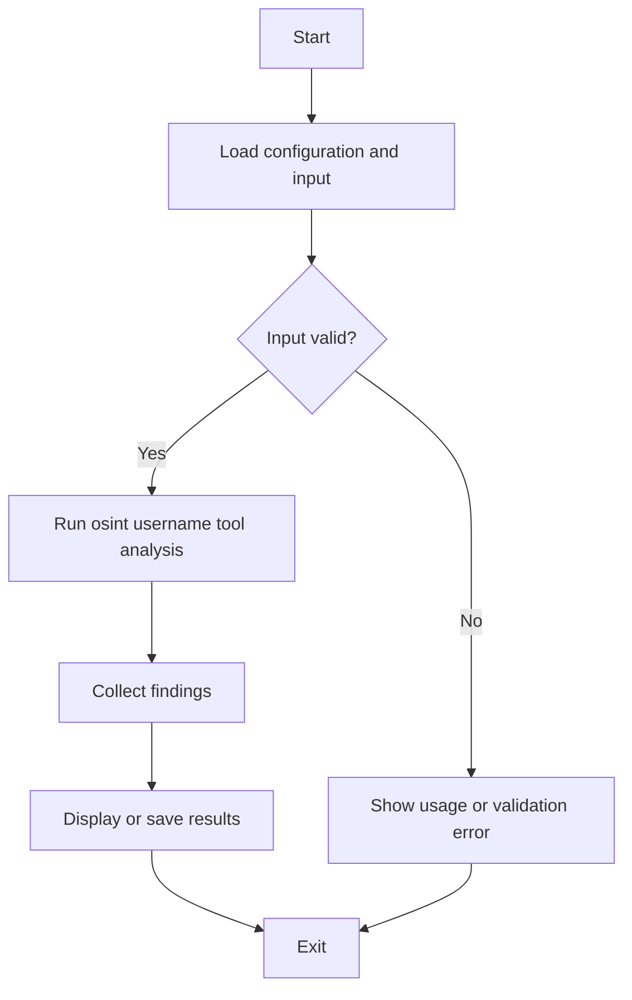

# 🕵️ USERNAME OSINT TOOL


## Get this repository

Clone the current project (this repository's canonical GitHub URL), then follow the installation and usage steps below.

```bash
git clone https://github.com/cyberworlduniversity/osint_username_tool.git
cd osint_username_tool
```

> **Find social and developer accounts across 40+ platforms by username.**  
> Fast · Async · Color-coded · Multi-format export

---

## 📖 Table of Contents

1. [What is OSINT?](#what-is-osint)
2. [Tool Overview](#tool-overview)
3. [Full Program Flow](#full-program-flow)
4. [Learning Procedure (How the Tool Works Internally)](#learning-procedure)
5. [All Definitions](#all-definitions)
6. [Supported Platforms](#supported-platforms)
7. [Installation](#installation)
8. [Usage Examples](#usage-examples)
9. [Output Formats](#output-formats)
10. [Project Structure](#project-structure)
11. [Ethical Use](#ethical-use)

---

## What is OSINT?

**OSINT** (Open-Source Intelligence) is the practice of collecting and analyzing publicly available information. In cybersecurity and digital investigations, OSINT tools automate the discovery of publicly accessible data — such as social media accounts, usernames, and digital footprints — without unauthorized access.

**Username OSINT** specifically focuses on identifying accounts across multiple platforms using a single identifier: a username.

---

## Tool Overview

| Property        | Value                          |
|-----------------|-------------------------------|
| Language        | Python 3.8+                   |
| Concurrency     | Async (aiohttp + asyncio)     |
| Platforms       | 40+ websites                  |
| Export Formats  | JSON, CSV, TXT                |
| Color Output    | Yes (colorama)                |
| Batch Support   | Yes (batch_scan.py)           |

---

## Full Program Flow

```
┌─────────────────────────────────────────────────────────────────┐
│                     PROGRAM EXECUTION FLOW                       │
└─────────────────────────────────────────────────────────────────┘

[1] CLI Argument Parsing
    │
    ├── username(s)      → positional args  (e.g., "johndoe")
    ├── --timeout        → per-request timeout in seconds
    ├── --concurrency    → max simultaneous HTTP requests
    ├── --found-only     → filter output to FOUND only
    ├── --quiet          → suppress live output
    ├── --output-dir     → folder for saved reports
    └── --format         → json | csv | txt

         │
         ▼

[2] Banner + Config Display
    │
    └── Prints the ASCII banner and scan parameters

         │
         ▼

[3] scan_username() — CORE ASYNC COROUTINE
    │
    ├── Creates aiohttp.ClientSession (with browser User-Agent)
    ├── Creates asyncio.Semaphore (limits concurrency)
    │
    ├── For each site in SITES dict:
    │       │
    │       └── Launches: check_site(session, name, config, username)
    │               │
    │               ├── Builds URL  → site_config["url"].format(username)
    │               ├── Sends GET request (non-blocking)
    │               ├── Reads HTTP status code
    │               ├── Compares against site's valid_codes list
    │               │
    │               ├── status == FOUND      → code in valid_codes (e.g. 200)
    │               ├── status == NOT FOUND  → code not in valid_codes
    │               ├── status == TIMEOUT    → asyncio.TimeoutError raised
    │               └── status == ERROR      → any other exception
    │
    ├── asyncio.gather() collects ALL results concurrently
    └── Returns ScanReport dataclass

         │
         ▼

[4] Live Output (verbose mode)
    │
    └── Each result printed as it arrives with color-coded status:
            ✓  GREEN  → FOUND
            ✗  RED    → NOT FOUND
            ⏱  YELLOW → TIMEOUT
            ?  GRAY   → ERROR

         │
         ▼

[5] print_summary()
    │
    └── Prints totals: found, not_found, errors, duration, progress bar

         │
         ▼

[6] Export Reports
    │
    ├── save_json() → full report with all fields
    ├── save_csv()  → found-only, tabular (site, url, status_code, ms)
    └── save_txt()  → human-readable full report

         │
         ▼

[7] Program Ends
    └── Exit 0
```

---

## Learning Procedure

This section explains **how to understand and extend** the tool — the learning path from beginner to advanced.

### Step 1 — Understand the Site Dictionary

The `SITES` dict is the heart of the tool:

```python
SITES = {
    "GitHub": {
        "url":    "https://github.com/{}",   # {} is replaced with username
        "method": "status",                   # detection method
        "valid":  [200],                      # HTTP codes that mean FOUND
    },
    ...
}
```

**To add a new site:**
1. Find the profile URL pattern (e.g., `https://example.com/users/{}`)
2. Open your browser's dev tools, load a known username's page → note the HTTP status
3. Load a random non-existent username → note the HTTP status
4. If they differ (e.g., 200 vs 404), you can detect existence
5. Add the entry to `SITES`

---

### Step 2 — Understand Async Execution

The tool uses **asyncio + aiohttp** for high-speed concurrent checks:

```
Traditional (sync):   Site1 → wait → Site2 → wait → Site3 ...  (slow)
Async (this tool):    Site1, Site2, Site3 ... all at once       (fast)
```

Key concepts:
- `async def` — defines a coroutine (non-blocking function)
- `await` — yields control while waiting for I/O
- `asyncio.gather()` — runs many coroutines concurrently
- `asyncio.Semaphore(N)` — caps concurrency at N simultaneous requests

---

### Step 3 — Data Flow Through Dataclasses

```
check_site()  →  SiteResult  →  collected into list
                                      │
                                      ▼
scan_username() → ScanReport  →  save_json / save_csv / save_txt
```

Both `SiteResult` and `ScanReport` are Python `@dataclass` objects — structured containers for results.

---

### Step 4 — Extend the Tool

| Goal                        | What to change                          |
|-----------------------------|------------------------------------------|
| Add a new website           | Add entry to `SITES` dict                |
| Change detection logic      | Modify `check_site()` — add body-text check |
| Add a new export format     | Write `save_html()` function             |
| Add proxy support           | Pass `proxy=` to `session.get()`         |
| Add rate limiting per-site  | Add per-site semaphores                  |

---

## All Definitions

| Term               | Definition |
|--------------------|------------|
| **OSINT**          | Open-Source Intelligence — gathering info from public sources |
| **Username**       | A public identifier used on platforms (e.g., `@johndoe`) |
| **HTTP GET**       | An HTTP request method that retrieves a resource from a URL |
| **Status Code**    | A 3-digit HTTP response code (200=OK, 404=Not Found, 403=Forbidden) |
| **asyncio**        | Python standard library for asynchronous concurrent programming |
| **aiohttp**        | Async HTTP client/server library for Python |
| **Coroutine**      | A special Python function defined with `async def` that can be paused and resumed |
| **Semaphore**      | A concurrency primitive that limits the number of simultaneous operations |
| **gather()**       | asyncio function that runs multiple coroutines concurrently and collects results |
| **SiteResult**     | Dataclass storing the outcome of checking one site for a username |
| **ScanReport**     | Dataclass aggregating all SiteResults for one username scan |
| **colorama**       | Python library for cross-platform ANSI color terminal output |
| **FOUND**          | Status meaning the username page returned a valid HTTP response code |
| **NOT FOUND**      | Status meaning the site returned a code not in the valid list (e.g. 404) |
| **TIMEOUT**        | Status meaning the site did not respond within the timeout window |
| **ERROR**          | Status meaning an unexpected exception occurred (e.g. DNS failure) |
| **Concurrency**    | Running multiple tasks at the same time (controlled by `--concurrency`) |
| **User-Agent**     | HTTP header identifying the client; set to a browser string to avoid blocks |
| **Wordlist**       | A plain text file with one username per line, used for batch scanning |
| **JSON**           | JavaScript Object Notation — structured data format used for full reports |
| **CSV**            | Comma-Separated Values — tabular format for found accounts |
| **TXT**            | Plain text report — human-readable summary of scan results |
| **@dataclass**     | Python decorator that auto-generates `__init__`, `__repr__` etc. from fields |
| **asdict()**       | dataclasses utility that converts a dataclass instance to a plain dict |
| **Redirect**       | HTTP 3xx response directing the client to another URL; followed automatically |
| **False Positive** | A FOUND result where the account does not actually exist (some sites always return 200) |
| **Digital Footprint** | The collection of accounts, posts, and data left by a person online |
| **Enumeration**    | The act of systematically checking whether a resource exists |

---

## Supported Platforms

### Social Media
GitHub · Twitter/X · Instagram · TikTok · Reddit · Pinterest · Tumblr · Facebook · LinkedIn · Snapchat

### Developer / Tech
GitLab · Bitbucket · HackerNews · StackOverflow · Replit · Dev.to · Codepen · Kaggle

### Creative / Music
SoundCloud · Spotify · Bandcamp · Flickr · Behance · Dribbble · DeviantArt · 500px

### Gaming
Steam · Twitch · Roblox · Minecraft (NameMC)

### Blogging / Professional
Medium · WordPress · Substack · About.me · Linktree

### Video
YouTube · Vimeo · Dailymotion

### Community / Startup
Keybase · ProductHunt · AngelList

---

## Installation

```bash
# 1. Clone or unzip the project
cd username_osint_tool

# 2. (Recommended) Create a virtual environment
python -m venv venv
source venv/bin/activate        # Linux/Mac
venv\Scripts\activate           # Windows

# 3. Install dependencies
pip install -r requirements.txt
```

---

## Usage Examples

### Single Username
```bash
python username_osint.py johndoe
```

### Multiple Usernames
```bash
python username_osint.py johndoe alice bob
```

### Show Only Found Accounts
```bash
python username_osint.py johndoe --found-only
```

### Export JSON + CSV + TXT
```bash
python username_osint.py johndoe --format json csv txt --output-dir results
```

### Faster Scan (Higher Concurrency)
```bash
python username_osint.py johndoe --concurrency 40 --timeout 8
```

### Batch Scan from Wordlist
```bash
python batch_scan.py sample_wordlist.txt --format json
```

### Quiet Mode (No Live Output)
```bash
python username_osint.py johndoe --quiet
```

---

## Output Formats

### JSON (`username_osint_YYYYMMDD_HHMMSS.json`)
Full structured report with all fields per site.

### CSV (`username_osint_YYYYMMDD_HHMMSS.csv`)
Found-only tabular export: `site_name, url, status_code, response_time_ms`

### TXT (`username_osint_YYYYMMDD_HHMMSS.txt`)
Human-readable full report with found accounts listed first.

---

## Project Structure

```
username_osint_tool/
│
├── username_osint.py      # Main tool — async scanner, CLI entry point
├── batch_scan.py          # Batch scanner for multiple usernames from file
├── requirements.txt       # Python dependencies
├── sample_wordlist.txt    # Example username list for batch scanning
└── README.md              # This file
```

---

## Ethical Use

⚠️ **This tool is intended for legitimate OSINT research only.**

- Only search for your own username or with explicit consent.
- Do not use this tool for stalking, harassment, or unauthorized data collection.
- Respect each platform's Terms of Service.
- Some platforms may block or rate-limit your requests.
- False positives can occur — always verify results manually.

The authors assume no liability for misuse.

---

*Built with Python · asyncio · aiohttp · colorama*


## Repository Quick Start

Clone this repository and enter its directory:

```bash
git clone https://github.com/cyberworlduniversity/osint_username_tool.git
cd osint_username_tool
```

### Requirements and installation

- Python 3.10+ is recommended.
- Create an isolated environment and install the pinned project dependencies:

```bash
python -m venv .venv
# Linux/macOS: source .venv/bin/activate
# Windows PowerShell: .venv\\Scripts\\Activate.ps1
python -m pip install -r requirements.txt
```

### Run

```bash
python username_osint.py
```

If the program presents command-line options, run `python username_osint.py --help` to view the options supported by the current version. Use a test target or sample input first.

### Validate the source

```bash
python -m compileall -q .
```

Use public information responsibly; do not harass, dox, or target private individuals.

### Program flow


